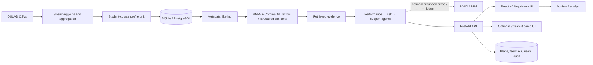

# System Architecture

Submission exports: [PDF diagram](../deliverables/architecture-diagram.pdf) and [JPEG diagram](../deliverables/architecture-diagram.jpg).

## Required RAG stages mapped to this implementation

| Reference stage | Eduvantage AI implementation |
|---|---|
| Dataset | OULAD CSV files: student, registration, assessment, VLE event/site, and course data |
| Preprocessing | Streaming VLE aggregation; keyed joins; assessment/activity feature derivation; profile upsert |
| Chunking | One structured student × module × presentation profile is the retrieval unit; no prose-window chunking |
| Embeddings | Local fixed-width HashingVectorizer vectors; no pretrained embedding API |
| Vector database | Persistent ChromaDB collection for student-profile vectors; SQLAlchemy remains authoritative for relational profile fields and application records |
| Retriever | Metadata filters, BM25, ChromaDB vector similarity, structured feature similarity |
| RAG / LLM | Retrieved profile evidence is included in analysis; NVIDIA NIM summary is optional and server-side |
| Agents | Performance analysis → risk assessment → support recommendation, coordinated by FastAPI |
| API layer | FastAPI REST endpoints; validation, authentication, role checks, and audit events |
| User interface | Primary React + Vite browser application; optional Streamlit demonstration client |

## Runtime request flow

Student profile vectors are persisted and searched in ChromaDB. SQL remains the source of truth for structured profile fields, users, access grants, interventions, feedback, and audit events. The main request runs from the UI through the API, which orchestrates filtering, retrieval, analysis, and persistence.

SQLite is the local default; set `DATABASE_URL` for PostgreSQL. Analysis is advisory. See the [design document](design-document.md), [dataset details](dataset-details.md), and [model card](model-card.md) for data assumptions and limitations.
